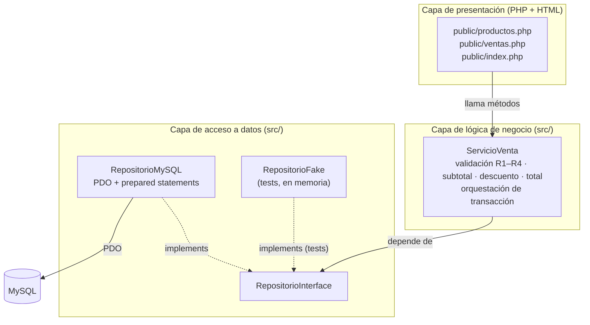
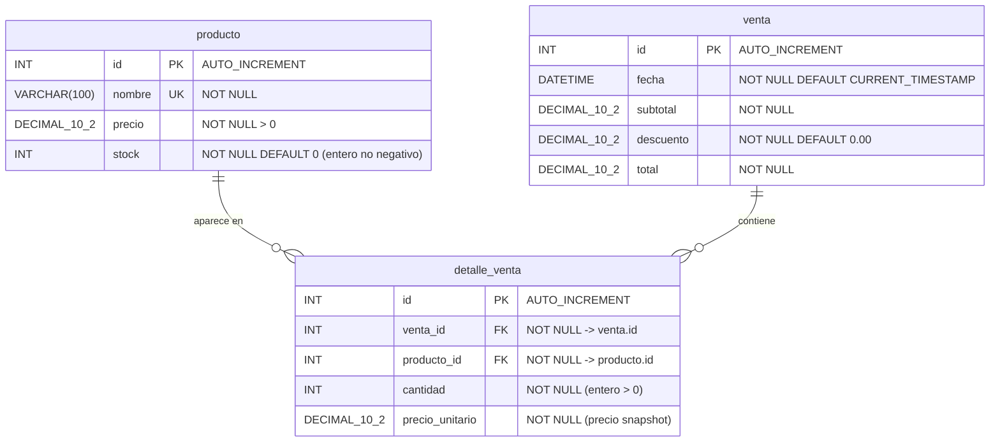

# Design Document — ventas-bodega

## Overview

El sistema «ventas-bodega» digitaliza el registro de ventas de la bodega «Doña Rosa» (San Vicente de Cañete), reemplazando el cuaderno donde actualmente anota las ventas. Esta versión cubre exclusivamente: registrar productos, registrar ventas, descontar el stock y aplicar descuento. No incluye autenticación de usuarios ni reportes.

**Stack tecnológico:** PHP 8 + MySQL sobre XAMPP, sin framework y sin librerías externas salvo PHPUnit.

**Decisiones clave de diseño:**

- **Arquitectura en tres capas** (presentación / lógica de negocio / acceso a datos) con dependencias unidireccionales.
- **Toda la lógica de las reglas R1–R4 se centraliza en `ServicioVenta`**, la cual no contiene HTML ni SQL directo.
- **Todo el SQL se confina en `RepositorioMySQL`**, que usa PDO con sentencias preparadas (INSERT/SELECT/UPDATE) para evitar inyección.
- **Inyección de dependencias para la testabilidad:** `ServicioVenta` depende de una interfaz `RepositorioInterface`, no de MySQL. En los tests se inyecta un `RepositorioFake` en memoria, de modo que `ServicioVenta` se prueba con PHPUnit **sin base de datos**.
- **Orquestación de transacciones en `ServicioVenta`, ejecución en `RepositorioMySQL`:** el `BEGIN/COMMIT/ROLLBACK` lo decide la lógica de negocio; las sentencias las ejecuta el repositorio. Así R4 (descontar stock en la misma transacción) y la reversión ante error (criterio 4.2) se prueban sin tocar MySQL.
- **Valores monetarios como `DECIMAL(10,2)`** en MySQL y redondeados a 2 decimales en PHP, para evitar errores de coma flotante.

## Architecture

### Capas y responsabilidades

| Capa | Ubicación | Responsabilidad | Qué NO contiene |
|---|---|---|---|
| Presentación | `public/*.php` (PHP + HTML) | Formularios, captura de input, invocar `ServicioVenta`, mostrar resultados y errores. | Lógica de negocio, SQL. |
| Lógica de negocio | `src/ServicioVenta.php` | Validar R1–R4, calcular subtotal/descuento/total, orquestar la transacción de la venta. | HTML, SQL directo. |
| Acceso a datos | `src/RepositorioMySQL.php` (+ `RepositorioInterface`) | Ejecutar INSERT/SELECT/UPDATE con PDO preparado; manejar la transacción física. | Reglas de negocio, HTML. |

La dirección de dependencias es estricta: Presentación → `ServicioVenta` → `RepositorioInterface` ← `RepositorioMySQL` → MySQL. `RepositorioMySQL` y `RepositorioFake` (tests) implementan la misma interfaz, lo que permite sustituir MySQL por una implementación en memoria.



### Diagrama de secuencia — Caso de uso «registrar venta»

Flujo: Usuario → Presentación → ServicioVenta → RepositorioMySQL → MySQL, con las validaciones de R1, R2, R3 y R4 marcadas en el momento en que ocurren dentro de `ServicioVenta`.

```mermaid
sequenceDiagram
    autonumber
    actor U as Doña Rosa
    participant P as Presentación<br/>(ventas.php)
    participant S as ServicioVenta
    participant R as RepositorioMySQL
    participant DB as MySQL

    U->>P: Ingresa producto + cantidad por línea
    P->>S: agregarLinea(productoId, cantidad)

    rect rgb(245, 245, 245)
    Note over S: R3 · valida que cantidad sea entero > 0
    alt cantidad NO es entero > 0
        S-->>P: error "cantidad inválida"
        P-->>U: muestra mensaje
    else cantidad válida
        S->>R: buscarProductoPorId(productoId)
        R->>DB: SELECT id,nombre,precio,stock WHERE id=:id
        DB-->>R: fila producto
        R-->>S: Producto(stock, precio)
        Note over S: R1 · valida cantidad ≤ stock disponible
        alt cantidad > stock
            S-->>P: error "cantidad excede el stock"
            P-->>U: muestra mensaje
        else cantidad ≤ stock
            S-->>P: línea aceptada
            P-->>U: muestra línea en pantalla
        end
    end
    end

    U->>P: Confirma la venta
    P->>S: registrarVenta(lineas)

    rect rgb(245, 245, 245)
    Note over S: valida que exista ≥ 1 línea válida (criterio 2.7)
    Note over S: R2 · subtotal = Σ(precio_unitario × cantidad)
    Note over S: R2 · si subtotal > 100 → descuento 5%; total = subtotal − descuento<br/>si subtotal ≤ 100 → descuento 0, total = subtotal
    S->>R: beginTransaction()
    R->>DB: START TRANSACTION
    S->>R: insertarVenta(fecha, subtotal, descuento, total)
    R->>DB: INSERT INTO venta (...) VALUES (...)
    R-->>S: ventaId

    loop por cada línea
        Note over S: R1 · re-valida cantidad ≤ stock (dentro de la transacción)
        S->>R: insertarDetalleVenta(ventaId, productoId, cantidad, precio)
        R->>DB: INSERT INTO detalle_venta (...) VALUES (...)
        Note over S,R: R4 · reduce stock en la misma transacción
        S->>R: actualizarStock(productoId, stock − cantidad)
        R->>DB: UPDATE producto SET stock=:stock WHERE id=:id
    end

    alt sin errores
        S->>R: commit()
        R->>DB: COMMIT
        S-->>P: Venta registrada (subtotal, descuento, total)
        P-->>U: muestra subtotal, descuento y total
    else error durante actualización de stock
        Note over S: R4 · revierte la transacción completa (criterio 4.2)
        S->>R: rollBack()
        R->>DB: ROLLBACK
        S-->>P: error "la Venta no pudo completarse"
        P-->>U: muestra mensaje; stock sin cambios
    end
    end
```

**Dónde se valida cada regla:**

- **R3 (Cantidad entera > 0):** en `ServicioVenta::agregarLinea`, antes de consultar el stock. Es una validación pura que no toca el repositorio.
- **R1 (Stock):** en `ServicioVenta`, dos veces — primero al agregar la línea (contra el stock leído) y luego al confirmar (re-validación dentro de la transacción para garantizar consistencia ante concurrencia).
- **R2 (Descuento):** en `ServicioVenta::registrarVenta`, como cálculo puro sobre el subtotal (subtotal > S/ 100,00 → 5 %; si no, 0).
- **R4 (Descontar stock en la misma transacción):** `ServicioVenta` orquesta `beginTransaction → insertarVenta → insertarDetalleVenta × N → actualizarStock × N → commit`, y `rollBack` ante cualquier error. Las sentencias las ejecuta `RepositorioMySQL`.

## Components and Interfaces

### `RepositorioInterface` (`src/RepositorioInterface.php`)

Contrato del que depende `ServicioVenta`. Lo implementan `RepositorioMySQL` (producción) y `RepositorioFake` (tests, en memoria).

```php
interface RepositorioInterface
{
    public function beginTransaction(): void;
    public function commit(): void;
    public function rollBack(): void;

    public function buscarProductoPorId(int $id): ?Producto;
    public function buscarProductoPorNombre(string $nombre): ?Producto;
    public function insertarProducto(string $nombre, float $precio, int $stock): int;
    public function actualizarStock(int $productoId, int $nuevoStock): void;

    public function insertarVenta(string $fecha, float $subtotal, float $descuento, float $total): int;
    public function insertarDetalleVenta(int $ventaId, int $productoId, int $cantidad, float $precioUnitario): void;
}
```

### `RepositorioMySQL` (`src/RepositorioMySQL.php`) — implementa `RepositorioInterface`

Recibe la conexión PDO por constructor y ejecuta todas las operaciones con sentencias preparadas.

```php
class RepositorioMySQL implements RepositorioInterface
{
    public function __construct(private PDO $pdo) {}

    public function beginTransaction(): void { $this->pdo->beginTransaction(); }
    public function commit(): void           { $this->pdo->commit(); }
    public function rollBack(): void          { $this->pdo->rollBack(); }

    public function buscarProductoPorId(int $id): ?Producto
    {
        $stmt = $this->pdo->prepare('SELECT id, nombre, precio, stock FROM producto WHERE id = :id');
        $stmt->execute([':id' => $id]);
        $fila = $stmt->fetch(PDO::FETCH_ASSOC);
        return $fila ? new Producto((int)$fila['id'], $fila['nombre'], (float)$fila['precio'], (int)$fila['stock']) : null;
    }
    // buscarProductoPorNombre, insertarProducto, actualizarStock, insertarVenta, insertarDetalleVenta
    // siguen el mismo patrón: prepare() + execute() con marcadores nombrados.
}
```

### `ServicioVenta` (`src/ServicioVenta.php`) — lógica de negocio

No contiene HTML ni SQL. Recibe el repositorio por inyección de dependencias.

```php
class ServicioVenta
{
    public function __construct(private RepositorioInterface $repo) {}

    // --- Registro de productos (Requisito 1) ---
    public function registrarProducto(string $nombre, float $precio, int $stock): int;

    // --- Registro de ventas (Requisito 2) ---
    public function agregarLinea(int $productoId, mixed $cantidadCandidata): Linea_Venta;

    // --- Confirmación de venta (Requisitos 2, 3, 4) ---
    public function registrarVenta(array $lineas): ResultadoVenta;

    // --- Helpers puros (objetivos de property-based testing) ---
    public function esCantidadValida(mixed $c): bool;          // R3
    public function esProductoValido(string $nombre, float $precio, int $stock): bool; // Req. 1
    public function calcularSubtotal(array $lineas): float;   // Req. 2.6
    public function calcularDescuento(float $subtotal): float; // R2
    public function calcularTotal(float $subtotal, float $descuento): float;
}
```

**Flujo de `registrarVenta`:**

1. Si `$lineas` está vacío → lanza `VentaVaciaException` (criterio 2.7).
2. Calcula `subtotal = Σ(precio_unitario × cantidad)` (criterio 2.6).
3. Calcula `descuento` con `calcularDescuento(subtotal)` (R2) y `total = subtotal − descuento`.
4. `$this->repo->beginTransaction()`.
5. `ventaId = $this->repo->insertarVenta(fecha, subtotal, descuento, total)`.
6. Por cada línea: re-valida `cantidad ≤ stock` (R1 dentro de la transacción), `insertarDetalleVenta(...)`, `actualizarStock(productoId, stock − cantidad)` (R4).
7. `$this->repo->commit()`. Devuelve `ResultadoVenta(ventaId, subtotal, descuento, total)`.
8. Ante cualquier excepción → `$this->repo->rollBack()` y relanza como `VentaNoCompletadaException` (criterio 4.2). El stock queda sin cambios.

### Objetos de valor (`src/`)

- `Producto(int $id, string $nombre, float $precio, int $stock)`
- `Linea_Venta(int $productoId, string $nombre, float $precioUnitario, int $cantidad)`
- `ResultadoVenta(int $ventaId, float $subtotal, float $descuento, float $total)`

### Capa de presentación (`public/`)

- `index.php` — panel con enlaces a registrar producto y registrar venta.
- `productos.php` — formulario (nombre, precio, stock) + handler `POST` que llama `ServicioVenta::registrarProducto`; muestra éxitos/errores.
- `ventas.php` — formulario para agregar líneas (producto + cantidad) y botón confirmar; llama `agregarLinea` por línea y `registrarVenta` al confirmar; muestra subtotal, descuento y total. Toda salida se escapa con `htmlspecialchars`.

### Construcción de dependencias (composición)

En producción, la presentación construye la cadena:
```php
$pdo = new PDO('mysql:host=localhost;dbname=bodega;charset=utf8mb4', $user, $pass, [
    PDO::ATTR_ERRMODE => PDO::ERRMODE_EXCEPTION,
    PDO::ATTR_EMULATE_PREPARES => false,
]);
$repo = new RepositorioMySQL($pdo);
$servicio = new ServicioVenta($repo);
```
En tests:
```php
$servicio = new ServicioVenta(new RepositorioFake());
```

## Data Models

### Diagrama entidad-relación



### DDL de MySQL

```sql
CREATE TABLE producto (
    id     INT AUTO_INCREMENT PRIMARY KEY,
    nombre VARCHAR(100) NOT NULL,
    precio DECIMAL(10,2) NOT NULL,
    stock  INT NOT NULL DEFAULT 0,
    UNIQUE KEY uq_producto_nombre (nombre),
    CONSTRAINT chk_producto_precio CHECK (precio > 0),
    CONSTRAINT chk_producto_stock  CHECK (stock >= 0)
) ENGINE=InnoDB DEFAULT CHARSET=utf8mb4;

CREATE TABLE venta (
    id        INT AUTO_INCREMENT PRIMARY KEY,
    fecha     DATETIME NOT NULL DEFAULT CURRENT_TIMESTAMP,
    subtotal  DECIMAL(10,2) NOT NULL,
    descuento DECIMAL(10,2) NOT NULL DEFAULT 0.00,
    total     DECIMAL(10,2) NOT NULL,
    CONSTRAINT chk_venta_descuento CHECK (descuento >= 0),
    CONSTRAINT chk_venta_total     CHECK (total = subtotal - descuento)
) ENGINE=InnoDB DEFAULT CHARSET=utf8mb4;

CREATE TABLE detalle_venta (
    id              INT AUTO_INCREMENT PRIMARY KEY,
    venta_id        INT NOT NULL,
    producto_id     INT NOT NULL,
    cantidad        INT NOT NULL,
    precio_unitario DECIMAL(10,2) NOT NULL,
    CONSTRAINT fk_detalle_venta    FOREIGN KEY (venta_id)    REFERENCES venta(id),
    CONSTRAINT fk_detalle_producto FOREIGN KEY (producto_id) REFERENCES producto(id),
    CONSTRAINT chk_detalle_cantidad CHECK (cantidad > 0)
) ENGINE=InnoDB DEFAULT CHARSET=utf8mb4;
```

**Notas de diseño:**

- `precio_unitario` se guarda en `detalle_venta` como **snapshot** del precio al momento de la venta, de modo que el histórico de ventas no se altere si luego se cambia el precio del producto.
- `InnoDB` es obligatorio para soportar transacciones (R4) y claves foráneas.
- Las restricciones `CHECK` refuerzan R1 (stock ≥ 0), R2 (total = subtotal − descuento) y R3 (cantidad > 0) a nivel de base de datos, pero la validación autoritativa vive en `ServicioVenta` para poder probarse sin MySQL.
- `UNIQUE(nombre)` materializa el criterio 1.4 (no duplicar productos por nombre).

## Correctness Properties

*A property is a characteristic or behavior that should hold true across all valid executions of a system — essentially, a formal statement about what the system should do. Properties serve as the bridge between human-readable specifications and machine-verifiable correctness guarantees.*

Las propiedades se prueban contra `ServicioVenta` inyectando un `RepositorioFake` en memoria, de modo que no se necesita MySQL. Las propiedades 1, 3 y 4 prueban helpers puros (sin repositorio); las demás usan el fake para simular el catálogo, el stock y los fallos de transacción.

### Property 1: Validación de cantidad

*Para cualquier* valor candidato de cantidad, el sistema lo acepta como cantidad válida de una `Linea_Venta` **si y solo si** es un entero estrictamente mayor que cero. Cero, negativos, decimales y valores no numéricos se rechazan.

**Validates: Requirements 2.1, 2.2**

### Property 2: Validación de stock al agregar una línea

*Para cualquier* producto con stock `s` y una cantidad válida `q` (entero > 0), la línea se acepta **si y solo si** `q ≤ s`. En particular, cuando `q = s` la línea se acepta (caso frontera).

**Validates: Requirements 2.3, 2.4**

### Property 3: Cálculo de subtotal

*Para cualquier* conjunto de líneas válidas de una venta, el subtotal calculado por el sistema es igual a `Σ(precio_unitario × cantidad)` sobre todas las líneas.

**Validates: Requirements 2.6**

### Property 4: Cálculo de descuento y total

*Para cualquier* subtotal `S`: el descuento es `round(S × 0.05, 2)` cuando `S > 100.00`, y `0` en caso contrario (incluido el caso exacto `S = 100.00`); el total es `round(S − descuento, 2)`. Ambos se expresan con 2 decimales.

**Validates: Requirements 3.1, 3.2, 3.3**

### Property 5: Reducción atómica de stock

*Para cualquier* venta válida confirmada, el stock resultante de cada producto es `stock_inicial − cantidad`, es un entero no negativo, y la actualización ocurre dentro de una sola transacción (`beginTransaction` … `commit`). En particular, cuando `cantidad = stock_inicial`, el producto permanece en el catálogo con stock `0` (no se elimina).

**Validates: Requirements 4.1, 4.3, 2.4**

### Property 6: Reversión ante error de stock

*Para cualquier* venta cuya actualización de stock falla durante la confirmación, el sistema revierte la transacción completa (se invoca `rollBack`, no `commit`), ningún producto cambia su stock, la venta no queda registrada y se señala el error.

**Validates: Requirements 4.2**

### Property 7: Venta sin líneas rechazada

*Para cualquier* intento de confirmar una venta que no contiene ninguna línea válida (lista vacía o todas las líneas rechazadas), el sistema rechaza la confirmación y no invoca ninguna operación de persistencia del repositorio.

**Validates: Requirements 2.7**

### Property 8: Producto duplicado rechazado

*Para cualquier* catálogo que ya contiene un producto de nombre `X`, el sistema rechaza el registro de otro producto con el mismo nombre `X`.

**Validates: Requirements 1.4**

### Property 9: Validación de registro de producto

*Para cualquier* intento de registrar un producto, el sistema lo acepta **si y solo si** el nombre no es vacío, el precio unitario es mayor que cero y el stock inicial es un entero no negativo. Cualquier otro caso se rechaza indicando el campo inválido.

**Validates: Requirements 1.1, 1.2**

## Error Handling

**Errores de dominio (validación):** se lanzan como excepciones de dominio desde `ServicioVenta` y la capa de presentación las captura para mostrar el mensaje al usuario, sin tocar MySQL:

| Excepción | Criterio | Origen |
|---|---|---|
| `CantidadInvalidaException` | 2.2 (R3) | `agregarLinea` — cantidad no es entero > 0 |
| `StockInsuficienteException` | 2.3 (R1) | `agregarLinea` / re-validación en `registrarVenta` — cantidad > stock |
| `VentaVaciaException` | 2.7 | `registrarVenta` — sin líneas válidas |
| `ProductoInvalidoException` | 1.2 | `registrarProducto` — nombre vacío / precio ≤ 0 / stock inválido |
| `ProductoDuplicadoException` | 1.4 | `registrarProducto` — nombre ya existe |
| `VentaNoCompletadaException` | 4.2 (R4) | `registrarVenta` — fallo en la transacción, tras `rollBack` |

**Errores de infraestructura:** `RepositorioMySQL` configura `PDO::ATTR_ERRMODE => PDO::ERRMODE_EXCEPTION`, de modo que cualquier fallo de SQL se propaga como `PDOException`. `ServicioVenta` lo captura dentro del bloque de la transacción, invoca `rollBack()` y lo relanza como `VentaNoCompletadaException`, garantizando que el stock queda sin cambios (criterio 4.2).

**Integridad transaccional (R4):** `registrarVenta` envuelve toda la operación en `beginTransaction → ... → commit`, con `rollBack` en el `catch`. Esto cumple R4 (descontar stock en la misma transacción) y el criterio 4.2 (revertir ante error) en el nivel de orquestación; la reversión física se confirma con un test de integración contra MySQL real.

**Precisión monetaria:** los montos se almacenan como `DECIMAL(10,2)` y se redondean en PHP con `round($x, 2)`. El redondeo se aplica al descuento y al total (criterio 3.1) para evitar errores de coma flotante.

**Seguridad:**
- Inyección SQL: todas las consultas usan sentencias preparadas con marcadores nombrados (`prepare`/`execute`); nunca se concatena input del usuario en SQL.
- XSS: la presentación escapa toda salida con `htmlspecialchars(..., ENT_QUOTES, 'UTF-8')`.
- No hay autenticación en esta versión (fuera de alcance); no se persisten credenciales.

## Testing Strategy

### Enfoque dual (unitarias + propiedades + integración)

- **Tests unitarios:** ejemplos concretos, casos frontera y condiciones de error sobre `ServicioVenta` con un `RepositorioFake` en memoria. Cubren integraciones internas entre los helpers y la orquestación de transacción.
- **Tests de propiedades (PBT):** verifican las propiedades universales de la sección *Correctness Properties* sobre un amplio espacio de entradas aleatorias.
- **Tests de integración:** `RepositorioMySQL` contra MySQL real en XAMPP (crear esquema, INSERT/SELECT/UPDATE y `ROLLBACK`) y el flujo completo de `registrar venta` de extremo a extremo. Cubren los criterios 1.3 y 2.5 (persistencia) que no son propiedades PBT.

### Property-based testing: decisión de biblioteca

El estándar de PBT para PHP es **Eris** (estilo QuickCheck). Sin embargo, los requisitos del proyecto prohíben librerías externas salvo PHPUnit ("sin framework y sin librerías externas salvo PHPUnit"). Por esa restricción, las pruebas de propiedades se implementan **con el mecanismo nativo de PHPUnit `@dataProvider`** más una clase utilitaria `Generadores` que produce entradas aleatorias (stocks, cantidades, precios, nombres, subtotales). Esto no es "implementar PBT desde cero": se apoya en el punto de extensión de PHPUnit (`@dataProvider`) y en un generador mínimo; se documenta la desviación y su motivo (restricción de dependencias del proyecto).

**Requisitos de las pruebas de propiedades:**
- Mínimo **100 iteraciones** por propiedad (vía un data provider que genere 100 entradas aleatorias con semilla fija para reproducibilidad).
- Cada prueba referencia su propiedad del diseño con un comentario de etiqueta.
- Formato de etiqueta: `Feature: ventas-bodega, Property {N}: {texto de la propiedad}`.
- Cada propiedad de la sección *Correctness Properties* se implementa con **una sola prueba de propiedad**.

### Asignación de criterios a tipo de prueba

| Criterio | Tipo | Notas |
|---|---|---|
| 1.1, 1.2 | PROPERTY | Property 9 (validación de producto) |
| 1.3 | INTEGRATION | INSERT + SELECT en MySQL real; aserción de contrato con fake |
| 1.4 | PROPERTY | Property 8 (duplicado) |
| 2.1, 2.2 | PROPERTY | Property 1 (cantidad, R3) |
| 2.3, 2.4 | PROPERTY | Property 2 (stock, R1); 2.4 es caso frontera |
| 2.5 | INTEGRATION | INSERT de venta y detalle_venta en MySQL real |
| 2.6 | PROPERTY | Property 3 (subtotal) |
| 2.7 | PROPERTY | Property 7 (venta vacía) |
| 3.1, 3.2, 3.3 | PROPERTY | Property 4 (descuento/total, R2); 3.2 es frontera |
| 4.1, 4.3 | PROPERTY | Property 5 (reducción atómica de stock, R4) |
| 4.2 | PROPERTY + INTEGRATION | Property 6 (rollback con fake) + integración de ROLLBACK en MySQL |

### Tests unitarios clave (ejemplos, no exhaustivos)

- Subtotal con 1, 2 y muchas líneas; descuento justo encima de 100, en 100 exacto y bajo 100; cantidad = stock exacto (stock → 0); venta con todas las líneas inválidas (rechazo sin tocar el repositorio); producto con stock 0 tras venta sigue en catálogo.

### Tests de integración (contra MySQL en XAMPP)

1. **Smoke:** conexión PDO y existencia del esquema (3 tablas).
2. `RepositorioMySQL::insertarProducto` + `buscarProductoPorNombre` (criterio 1.3).
3. `registrarVenta` de extremo a extremo: verificar `venta`, `detalle_venta` y `producto.stock` actualizado (criterios 2.5, 4.1).
4. **Rollback real:** simular un fallo (por ejemplo, violar una restricción) y verificar que `producto.stock` no cambia (criterio 4.2).

### Configuración

- `phpunit.xml` (ya existe) arranca con `src/ServicioVenta.php` y la suite `tests`.
- Los tests de propiedades usan `@dataProvider` con un generador de 100 casos y semilla fija.
- Los tests de integración usan una base de datos de prueba en XAMPP y la limpian entre ejecuciones (transacciones de prueba o `TRUNCATE`).
